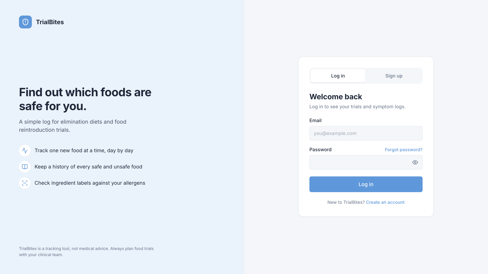
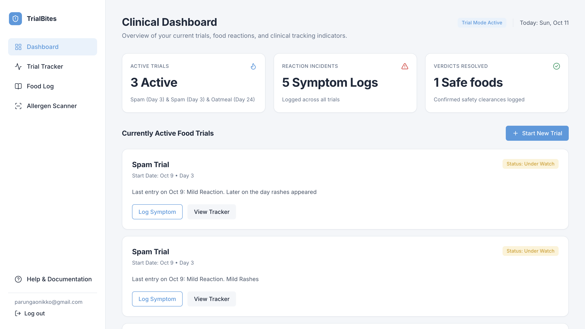
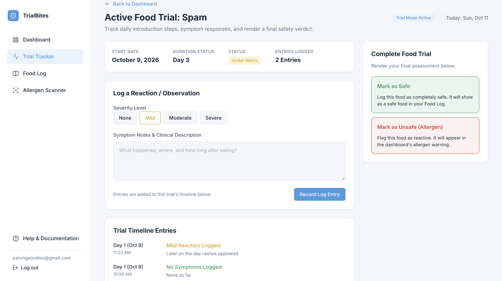
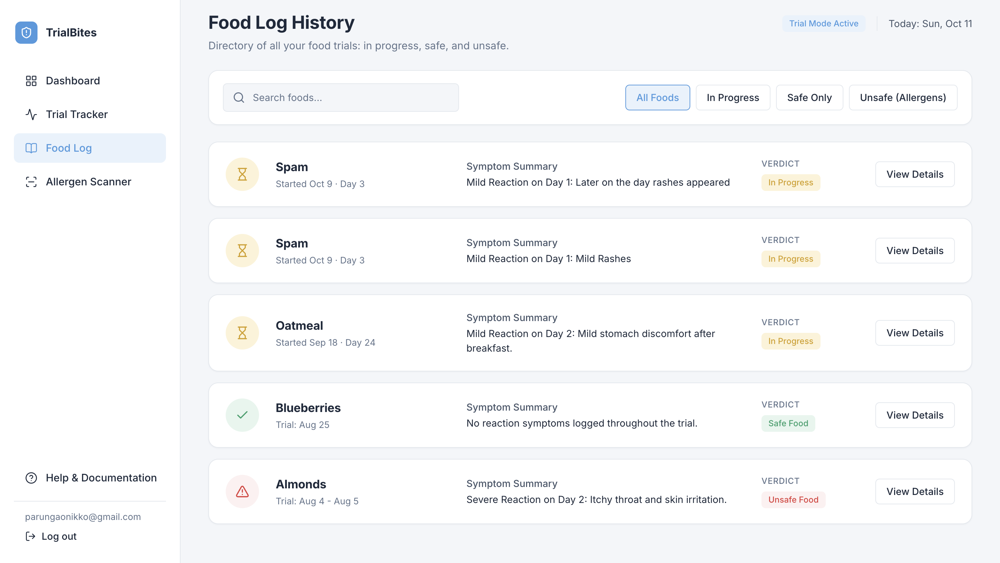
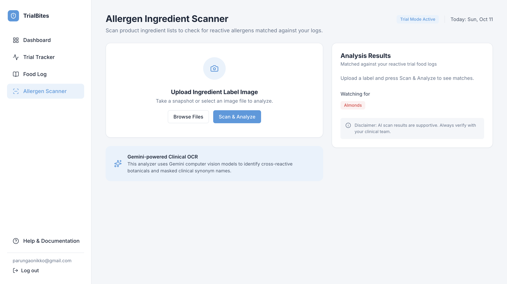

# TrialBites: Documentation

<p align="center">
  
</p>

Everything a new reader needs to understand TrialBites, get it running from nothing, and use it.
Short version and presentation links: [README.md](README.md).

- **Public repository:** https://github.com/nikkops/TrialBites
- **Live app:** https://trial-bites.vercel.app/

## Contents

1. [Overview](#1-overview)
2. [Setup and installation](#2-setup-and-installation)
3. [How to run it](#3-how-to-run-it)
4. [Features and usage](#4-features-and-usage)
5. [Project structure](#5-project-structure)
6. [Screenshots](#6-screenshots)
7. [Known issues and next steps](#7-known-issues-and-next-steps)

Also: [Security checklist](#security-checklist) · [AI usage](#ai-usage) · [More documentation](#more-documentation) · [Credits](#credits)

---

## 1. Overview

TrialBites is a food-trial tracker for people doing a single-food elimination diet or food reintroduction. You start a trial for one food, log your reactions day by day, and give it a final **safe** or **unsafe** verdict. The app keeps a searchable history of every food you've tried, warns you about the ones marked unsafe, and can scan a photo of an ingredient label with Google Gemini to flag ingredients that match them, including hidden or scientific names like *Arachis hypogaea* for peanut.

**Who it's for:** anyone doing a food elimination or allergen trial under medical guidance who wants one place to track each food, their reactions, and the final verdict, instead of notes scattered across a phone. Each person has their own account, and their trials are private to them.

**Built with**

| Part | Technology | Folder |
|---|---|---|
| Frontend | React + Vite, plain CSS, [Lucide](https://lucide.dev/) icons | `src/` |
| Database and login | Supabase (Postgres, Supabase Auth, Row Level Security) | `supabase/schema.sql` |
| Label scanner | Supabase Edge Function (Deno) calling Google Gemini | `supabase/functions/scan-label/` |
| Hosting | Vercel (static site), deployed from GitHub | |

There is no separate server: the browser talks to Supabase directly with the
publishable key, and Row Level Security in the database decides what each user
can read and change. The only server-side code is the scanner's Edge Function,
which keeps the Gemini key off the browser.

## 2. Setup and installation

Follow these steps in order to get the app running on your own computer from nothing.

### 2.1 What to install first

| Tool | Version | Why |
|---|---|---|
| [Node.js](https://nodejs.org/) + npm | **22 LTS** (or 20.19+) | runs Vite, the dev server and build tool |
| [Git](https://git-scm.com/) | any | to clone the repository |
| A [Supabase](https://supabase.com/) account and project | free plan | hosts the database, the login and the scanner function |
| A [Google AI Studio](https://aistudio.google.com/) API key | free tier | **only** for the Allergen Scanner |

Create the Supabase project now (**New project** in the [Supabase dashboard](https://supabase.com/dashboard)).

### 2.2 Get the code

```bash
git clone https://github.com/nikkops/TrialBites.git
cd TrialBites
```

### 2.3 Install dependencies

```bash
npm install
```

### 2.4 Environment and configuration

Copy the example file, then replace the placeholders with your own values. **Never commit the real file.** Vite's `.gitignore` already ignores `.env.local`.

```bash
cp .env.example .env.local
```

**Frontend: `.env.local`**

| Variable | Example value | Where to find it |
|---|---|---|
| `VITE_SUPABASE_URL` | `https://your-project-ref.supabase.co` | Supabase → Project Settings → API Keys |
| `VITE_SUPABASE_PUBLISHABLE_KEY` | `sb_publishable_your-publishable-key` | Supabase → Project Settings → API Keys → Publishable key |

The `VITE_` prefix is what lets Vite pass a variable to the React code, which also means it ends up in the browser. That's fine for the publishable key, because Row Level Security protects the data. **Never** put the `service_role` / secret key in a `VITE_` variable.

**Scanner: Supabase Edge Function secrets** (Supabase → Edge Functions → Secrets)

| Secret | Example value | Notes |
|---|---|---|
| `GEMINI_API_KEY` | `AIza-your-gemini-key` | **Secret.** From Google AI Studio → Get API key. Restrict it to the Generative Language API. Never put it in `.env.local` or any file in the repo. |
| `GEMINI_MODEL` | `gemini-3.8-flash` | Optional; this is the default. |
| `GEMINI_FALLBACK_MODEL` | another Gemini flash model | Optional; tried once if the main model stays busy. |
| `ALLOWED_ORIGINS` | `https://trial-bites.vercel.app,http://localhost:5173` | Optional; these two are the default. The websites allowed to call the scanner from a browser. Add your own URL if you deploy elsewhere. |

`SUPABASE_URL` and `SUPABASE_ANON_KEY` are provided to the function by Supabase automatically.

### 2.5 Set up the database

1. In Supabase, open **SQL Editor → New query**, paste in all of [`supabase/schema.sql`](supabase/schema.sql), and click **Run**. It creates:
   - `trials`: one row per food trial, owned by the user who created it
   - `symptoms`: one row per logged reaction, linked to a trial
   - Row Level Security on both tables, so each user only sees their own data

   Afterwards, **Advisors → Security** should show no RLS warnings.
2. **Authentication → URL Configuration:** set **Site URL** to `http://localhost:5173` (or your live URL) and add `http://localhost:5173` to **Redirect URLs**. Password reset emails use these.
3. **Authentication → Sign In / Providers → Email:** turn **Confirm email** off. Supabase's built-in email sender only allows a few emails an hour, so confirmation emails can't be relied on without custom SMTP.

**Seeding:** there is no seed script, on purpose. Every trial belongs to a user, so sample data would have no owner. To get data, sign up in the app and use **Start New Trial** (section 4 walks through it).

### 2.6 Turn on the Allergen Scanner (optional)

Everything else works without this step.

1. Add the secrets from the table in 2.4.
2. Go to **Edge Functions → Deploy a new function → Via Editor**, name it exactly `scan-label`, paste in [`supabase/functions/scan-label/index.ts`](supabase/functions/scan-label/index.ts), leave **Verify JWT** on, and click **Deploy**. This saves the function into your Supabase project.

## 3. How to run it

```bash
npm run dev
# → VITE ready … Local: http://localhost:5173/
```

**What you should see when it works**

- **http://localhost:5173** shows the login page: *"Find out which foods are safe for you."* on the left, and a **Log in / Sign up** card on the right.
- After signing up, you land on the **Clinical Dashboard** with an empty "Currently Active Food Trials" section and a **Start New Trial** button.
- In the Allergen Scanner, with at least one trial marked unsafe, scanning a label shows **Analysis Results** within a few seconds.

**When it doesn't**

| What you see | Cause |
|---|---|
| A blank page, and the browser console says `supabaseUrl is required` or `supabaseKey is required` | `.env.local` is missing, in the wrong folder, or the variable names don't match `src/lib/supabase.js`. Restart `npm run dev` after fixing it, since Vite only reads `.env.local` on startup. |
| "Couldn't load your trials" | The database tables don't exist yet (run `schema.sql`) or the keys are for a different project. |
| "The scanner is busy right now" | Gemini is overloaded. Wait a minute and try again. |
| Any other scanner error | The details are in Supabase → **Edge Functions → scan-label → Logs**. |

**Other commands**

| Command | What it does |
|---|---|
| `npm run build` | Production build into `dist/` |
| `npm run preview` | Serve the production build locally |
| `npm run lint` | ESLint |

**To put it online:** import the repository into [Vercel](https://vercel.com/), add the two `VITE_` variables under **Settings → Environment Variables** with **Type: Config** (Vercel won't save `VITE_` variables as Secrets, because they're public by design), deploy, and set the live URL as the **Site URL** in Supabase.

## 4. Features and usage

### The main flow

1. **Sign up or log in** with email and password (Supabase Auth). Sign-up asks you to confirm your password (at least 8 characters). **Forgot password?** emails a reset link that opens a "Set a new password" form.
2. **Start a trial** with **Start New Trial** on the Dashboard: enter the food and its start date (today by default; future dates aren't allowed). The new trial opens in the **Trial Tracker**.
3. **Log reactions** in the Trial Tracker: pick a severity (**None**, **Mild**, **Moderate**, **Severe**) and describe what happened. Each entry appears in the timeline with its trial day, date and time. If saving fails, what you typed is kept.
4. **Watch its status** on the Dashboard. Each active trial shows **Baseline** (nothing logged yet), **Under Watch** (at least one reaction), or **No Reactions** (only "None" entries).
5. **Give a verdict** with **Mark as Safe** or **Mark as Unsafe (Allergen)**. The date of the verdict is saved. Unsafe foods appear in the Dashboard's red **Clinical Allergen Shield** warning.
6. **Look back** in the **Food Log**: every trial, searchable by name, with filters for **In Progress**, **Safe Only** and **Unsafe (Allergens)**, each showing its dates, its worst reaction and its verdict.
7. **Scan a label** in the **Allergen Scanner**: upload or take a photo of an ingredient list and press **Scan & Analyze**. The app shrinks the photo, Gemini reads it, and the results list every ingredient that matches one of your unsafe foods, why it matches (a scientific name, "derived from milk", a "may contain" warning), and every ingredient it read.
8. **Log out** from the bottom of the sidebar.

### Data functions

There is no custom REST API. The app reads and writes through the Supabase client, and all of that code lives in `src/lib/`, so the pages never call Supabase directly. Every function throws a readable error, which `App.jsx` shows in a banner.

| File | Function | What it does |
|---|---|---|
| `trialsApi.js` | `fetchTrials()` | All of my trials with their symptoms in one request, newest first |
| `trialsApi.js` | `createTrial({ foodName, startDate })` | Start a new active trial |
| `trialsApi.js` | `addSymptom(trialId, { severity, notes })` | Log a reaction with today's local date |
| `trialsApi.js` | `updateTrialStatus(trialId, status)` | Set the verdict and record when it was given |
| `authApi.js` | `signUp` · `logIn` · `logOut` | Account access |
| `authApi.js` | `sendPasswordReset` · `updatePassword` | Forgot-password flow |
| `authApi.js` | `onAuthChange(callback)` | Tells the app when someone logs in or out |
| `scannerApi.js` | `scanLabel(file)` | Shrinks a photo and sends it to the scanner function |

**Database tables** (full definitions in [`supabase/schema.sql`](supabase/schema.sql))

| Table | Columns | Rules |
|---|---|---|
| `trials` | `id`, `user_id`, `food_name`, `start_date`, `status`, `completed_at`, `created_at` | `status` is `active`, `safe` or `unsafe`. `user_id` defaults to the logged-in user. You can only see and change your own. |
| `symptoms` | `id`, `trial_id`, `symptom_date`, `severity`, `notes`, `created_at` | `severity` is 0–10 (the app saves 0 / 2 / 5 / 8). You can only see and change symptoms on your own trials. Deleted with their trial. |

### Scanner endpoint

| Method | Path | What it does |
|---|---|---|
| POST | `/functions/v1/scan-label` | Reads an ingredient label photo and matches it against my unsafe foods |

It needs `Authorization: Bearer <Supabase access token>`, which `supabase.functions.invoke` sends automatically. The function looks up your unsafe foods itself, under your own login, so Row Level Security still applies, and it only returns matches for foods you've actually marked unsafe.

Request:
```json
{ "image": "<base64 JPEG, PNG or WebP>", "mimeType": "image/jpeg" }
```

Response:
```json
{
  "readable": true,
  "ingredients": ["Wheat flour", "Peanut flour", "Salt"],
  "matches": [
    { "ingredient": "Peanut flour", "allergen": "Peanuts", "synonym": "Arachis hypogaea" }
  ],
  "allergensChecked": ["Peanuts"]
}
```

| Status | Meaning |
|---|---|
| **200** | Scan finished. `readable: false` if the photo wasn't a readable label. |
| **400** | No image, or not a JPG / PNG / WebP |
| **401** | Not logged in |
| **413** | Image too large |
| **503** | Gemini is busy, after 2 automatic retries and the optional fallback model |
| **500 / 502** | The function or Gemini failed; the full error is in the function's logs |

## 5. Project structure

```
trialbites/
├── src/                          React frontend
│   ├── main.jsx                  entry point, renders AuthGate
│   ├── AuthGate.jsx              shows the login page or the app, depending on who's logged in
│   ├── App.jsx                   loads trials, handles saving, switches between screens
│   ├── index.css                 colors, fonts, buttons, cards and badges shared by every page
│   ├── pages/                    one file (+ .css) per screen: AuthPage, Dashboard, TrialTracker, FoodLog, AllergenScanner
│   ├── components/               AppShell (sidebar + log out), PageHeader, NewTrialDialog
│   ├── lib/                      supabase.js (client), trialsApi.js, authApi.js, scannerApi.js
│   └── utils/trialHelpers.js     dates, times, trial day, severity and status badges
├── supabase/
│   ├── schema.sql                tables and Row Level Security, run once on a new project
│   ├── hardening.sql             adds the length rules to a database created before they existed
│   └── functions/scan-label/     the Edge Function that sends label photos to Gemini
├── public/                       favicon.svg (tab icon), apple-touch-icon.png (phone home screen)
├── images_documentation/         the screenshots in section 6
├── index.html                    page title, tab icon, mounts the app at #root
├── .env.example                  example environment variables
├── README.md                     project summary and quick start
├── DOCUMENTATION.md              this file
├── SECURITY-CHECKLIST.md         completed security checklist
└── AI-USAGE.md                   how AI was used
```

## 6. Screenshots

| Log in | Dashboard |
|---|---|
|  |  |

| Trial Tracker | Food Log |
|---|---|
|  |  |

| Allergen Scanner |
|---|
|  |

## 7. Known issues and next steps

**Known issues**

- **The scanner can be wrong.** Gemini can miss an ingredient or misread a blurry photo, and a missed allergen is a real safety risk. The app shows a disclaimer to verify results with a clinical team, but it is a helper, not a guarantee.
- **The scanner can be busy.** At peak times Gemini returns "high demand" errors. The function retries twice and can fall back to a second model, but scans can still fail.
- **The scanner has no per-user limit.** Any logged-in user can scan as often as they like, and every scan uses the project's Gemini quota.
- **Email confirmation is off**, because Supabase's built-in email sender is rate-limited. So anyone can sign up with an email address they don't own.
- **The 8-character password minimum is only checked in the app.** Supabase's own minimum is lower unless it's raised in Authentication settings.
- **Trial length and dosage aren't tracked.** The mockup shows "Day 3 of 6" and a feeding dosage, but there are no columns for them yet.
- **Trials and entries can't be edited or deleted** from the app, and an entry is always saved under today's date, so earlier days can't be backfilled. Entry times are when the entry was logged, not when the reaction happened.
- **The Help & Documentation button doesn't do anything yet.**
- **No routing library.** Screens switch through state in `App.jsx`, so they don't have their own URLs, and the browser's back button leaves the app.
- **No automated tests and no CI.** Features were tested by hand and with one-off browser scripts.

**Next steps**

1. Add `planned_days` and `dosage` columns so trials show "Day 3 of 6" and the feeding dosage.
2. Let users edit and delete trials and entries, and choose an entry's date and time.
3. Add a daily scan limit per user in the Edge Function.
4. Set up custom SMTP, turn **Confirm email** back on, and raise Supabase's minimum password length to 8.
5. Build the Help & Documentation page, and add React Router so each screen and trial has its own URL.
6. Add tests for `src/lib/` and the main flows, and a GitHub Actions workflow that runs lint and tests.

---

## Security checklist

The completed security checklist is in [SECURITY-CHECKLIST.md](SECURITY-CHECKLIST.md). Every row is answered Yes, No or N/A with what was checked.

## AI usage

Built with AI assistance from Claude (Anthropic). Details: [AI-USAGE.md](AI-USAGE.md).

## More documentation

| Document | What's in it |
|---|---|
| [README.md](README.md) | Project summary, quick start, presentation and AI usage links |
| [supabase/schema.sql](supabase/schema.sql) | The database tables and Row Level Security policies, with comments |
| [supabase/functions/scan-label/index.ts](supabase/functions/scan-label/index.ts) | The label scanner, including the instructions sent to Gemini |
| [SECURITY-CHECKLIST.md](SECURITY-CHECKLIST.md) | Completed security checklist |
| [AI-USAGE.md](AI-USAGE.md) | How AI was used in this project |

## Credits

- **Font:** [Inter](https://fonts.google.com/specimen/Inter) via Google Fonts (SIL Open Font License).
- **Icons:** [Lucide](https://lucide.dev/) via `lucide-react` (ISC license). The logo and tab icon use Lucide's *shield-alert* icon.
- **Label reading:** [Google Gemini API](https://ai.google.dev/).
